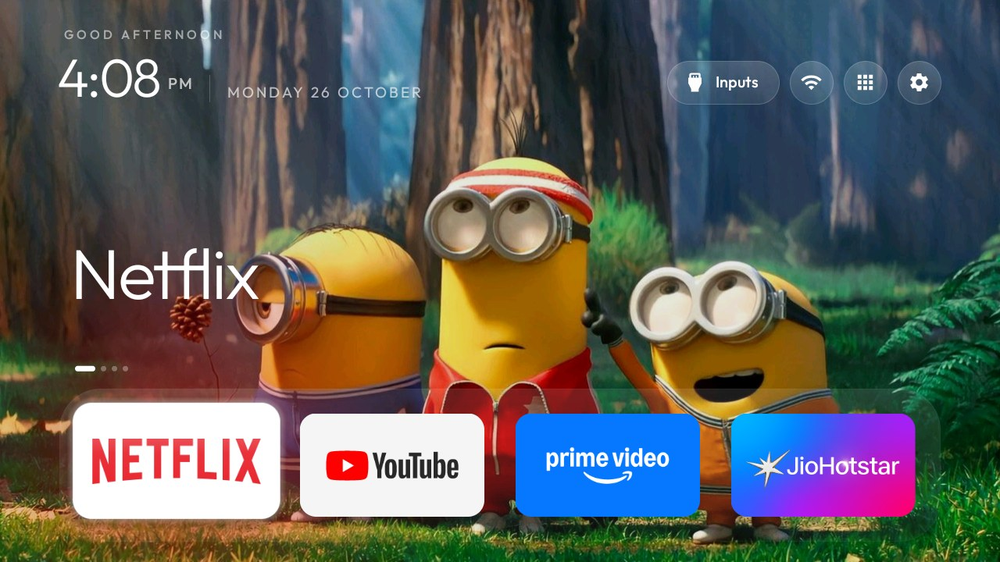
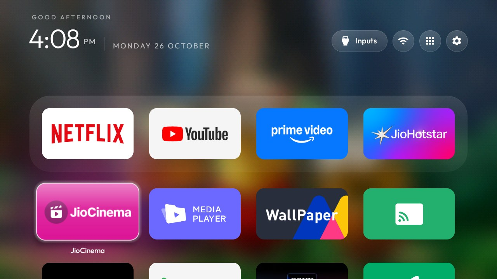

# TV Launcher (VisionOS Edition)

<p align="center">
  
</p>

<p align="center">
  
  
  
  
  
</p>

A custom, ultra-lightweight, and privacy-focused Android TV launcher fork inspired by **Apple visionOS** and **CleanYourTV**. Built specifically to replace sluggish, ad-bloated TV home screens with a clean, high-performance interface featuring **liquid glass dock styling**, **silky photographic scroll blur**, and **dynamic time-of-day wallpapers**.

---

## ✨ What Makes This Fork Different?

| Feature | Standard CleanYourTV / Stock Launcher | This VisionOS Edition |
| :--- | :--- | :--- |
| **Dock Style** | Flat opaque / dark smoked baseplate | **Liquid Glass Frosted Dock** with specular gradient rim |
| **Grid Scroll Effect** | Static wallpaper or low-res pixelated stretch | **High-Definition Smooth Gaussian Scroll Blur** ($384 \times 216$) |
| **Wallpaper Engine** | Static or simple sunrise/sunset cycle | **4-Stage Time-of-Day Wallpapers** (Morning, Afternoon, Evening, Night) |
| **Focus Highlight** | App-specific colored glow halo | **Uniform Glassomorphic Pure White Rim** |
| **Dock Placement** | Second row partially visible | **Clean Bottom Dock** with subsequent rows hidden until scrolled |
| **APK Footprint** | Bloated stock (~50–150 MB) | **Under 480 KB** (< 491,520 bytes) with zero tracking or ads |

---

## 📸 Screenshots from Real TV

### 1. Liquid Glass Bottom Dock (100% Crisp Wallpaper)
At home rest, the dock floats cleanly at the bottom edge of the screen over an unblurred high-res wallpaper.
<p align="center">
  
</p>

### 2. Silky Photographic Background Blur on Scroll
When scrolling down into the app library / grid rows, the wallpaper transitions smoothly into a soft photographic blur (inspired by iOS / Samsung notification shade) with zero pixelation or edge artifacts.
<p align="center">
  
</p>

---

## 🕒 Dynamic Time-of-Day Wallpapers

The launcher automatically schedules and switches wallpapers in the background according to the time of day:

| Mood | Time Window | Scene / Wallpaper |
| :--- | :--- | :--- |
| 🌅 **Morning** | `07:00 AM – 12:00 PM` | Serene Lord Krishna illustration |
| ☀️ **Afternoon** | `12:00 PM – 05:00 PM` | Minions in Redwood Forest |
| 🌇 **Evening** | `05:00 PM – 07:00 PM` | Samurai overlooking Mt. Fuji at twilight |
| 🌙 **Night** | `07:00 PM – 07:00 AM` | Two cats sitting on a roof under starry night sky |

*(All wallpapers are stored in `themes/visionos/wallpapers/` and mapped in `themes/visionos/config.json`)*.

---

## 🚀 Key Improvements & Architecture

### 1. Liquid Glass Shader (`DockDecoration.java`)
- Translucent multi-stop linear gradient (`0x33FFFFFF` to `0x14FFFFFF`).
- Subtle top specular rim (`0x44FFFFFF` to `0x22FFFFFF`) matched to status pills.
- Removed dark under-plate so vibrant wallpaper colors naturally illuminate the glass dock.

### 2. Fast $O(1)$ Sliding-Window Blur (`WallpaperPlayer.java`)
- Generates a cached downscaled $384 \times 216$ blur texture in the background using a 3-pass horizontal and vertical box blur algorithm (`radius = 7`).
- Alpha-blends dynamically with `RecyclerView` scroll offset ($0.0 \to 1.0$).
- Fast and fluid 60 FPS performance on 1 GB RAM Android TVs with zero CPU choke.

### 3. Dedicated Afternoon Mood Slot (`WallpaperMood.java`)
- Extended upstream time-of-day engine to include `AFTERNOON` (12:00 PM – 5:00 PM).
- Minute-by-minute automatic transition trigger.

---

## 🛠️ Build & Installation

### Requirements:
- Java JDK 17+
- Android SDK Platform 34 & Build-Tools 34.0.0
- Python 3.9+ with `Pillow` and `adb` installed

### 1. Build the Release APK
```bash
cd launcher
./gradlew assembleRelease
```
The compiled APK will be output to:
```
launcher/app/build/outputs/apk/release/app-release.apk
```

### 2. Install onto Android TV via ADB
Connect to your TV's IP address:
```bash
adb connect <your-tv-ip>:5555
adb -s <your-tv-ip>:5555 install -r launcher/app/build/outputs/apk/release/app-release.apk
```

### 3. Push the VisionOS Theme & Wallpapers
```bash
# Windows PowerShell
powershell -ExecutionPolicy Bypass -File tools\theme.ps1 -TvHost <your-tv-ip> themes\visionos

# Linux / macOS
tools/theme.sh -TvHost <your-tv-ip> themes/visionos
```

---

## 🛡️ Credits & Upstream

This project is a customized fork of [CleanYourTV](https://github.com/Gathin23/cleanyourtv) by [@Gathin23](https://github.com/Gathin23). Upstream tools, TV debloat lists, restore procedures, and ADB helpers remain fully compatible.
